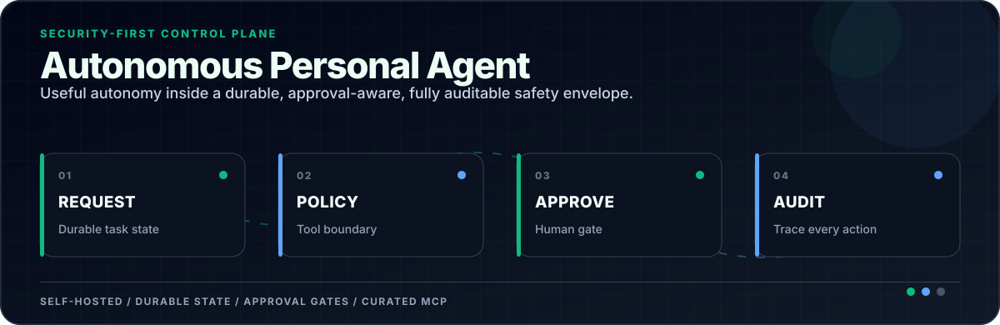
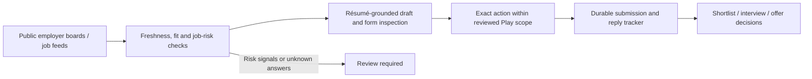
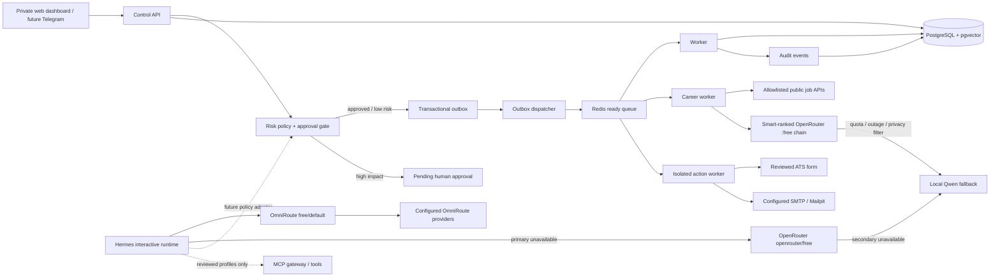
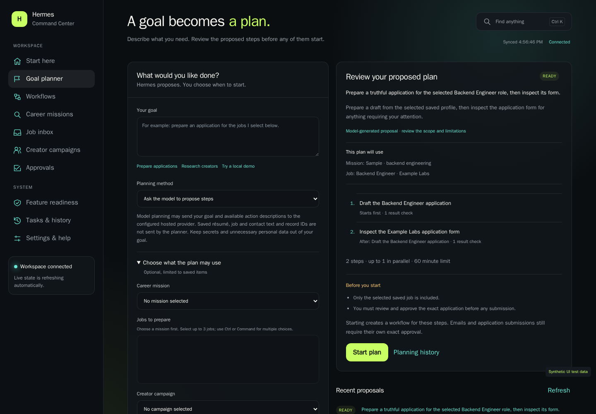

<div align="center">



</div>

[](https://github.com/ReaperXD67/autonomous-personal-agent/actions/workflows/ci.yml)
[](LICENSE)
[](#implemented-now)

**Find relevant jobs and internships. Prepare truthful applications. Track the replies that matter.**

Hermes is a private, self-hosted agent workspace for career missions and creator
outreach. Save your résumé, identity, target roles, locations and employer boards.
The career worker discovers and ranks opportunities, explains job-risk signals,
prepares application material, and can submit supported applications within an
explicit, expiring Play scope. Read-only Gmail tracking brings shortlist,
interview and offer signals into a **Your next decisions** queue with source
evidence and review of uncertain matches.

Discovery, age-independent fit, mandatory-qualification checks, source/filter diagnostics, URL import, job-risk
and draft-evidence checks, and reply classification make
**zero model calls**. Models handle application writing through configured free
hosted routes or local Qwen; generation still consumes tokens and compute.
The existing Minecraft creator workflow researches public channels, prepares
paid-collaboration proposals, tracks replies and hands confirmed interest to you.
PostgreSQL owns task state, budgets, approvals and audit; isolated workers execute
bounded actions.



**Start here:** [Career Play and Gmail](docs/operations/career-autopilot.md)
· [Local proof](#quick-start-windows--docker-desktop)
· [Minecraft creator workflow](docs/operations/minecraft-creator-workflow.md)
· [Continue creator outreach](docs/operations/creator-outreach-continuation.md)
· [Organic promotion playbook](docs/research/karixmc-growth-playbook-2026-11.md)
· [Architecture](docs/architecture/overview.md)
· [Roadmap](docs/roadmap.md)

> [!IMPORTANT]
> **Local-alpha status:** the private web dashboard, scheduled fresh-job
> discovery, matching, tracking, local application drafting, exact-action review,
> isolated single-page ATS submission, and test-sink email work. Career Play can
> authorize bounded automatic applications within an explicit, expiring scope;
> manually prepared actions retain exact-action approval. Creator runs can authorize
> template introductions and optional handoffs within a finite campaign scope;
> AI creator drafts require individual exact-message review.
> Contact qualification and positive-reply confirmation stay reviewed. Creator Gmail
> reading needs read-only OAuth and its own real canary. Discord is a handoff contact,
> not a connected account. Telegram,
> generic browser automation, coding workers, and broad MCP access are not
> enabled. Never expose the dashboard port directly to the internet.
> The Linux VPS commands prepare a private single-operator deployment reached
> through SSH/VPN; they do not turn this alpha into a public multi-user service.

## Why this exists

Useful autonomy needs more than a generated email. This project keeps the
evidence, message, recipient, decision, and delivery result together so you can
understand what happened and take over at the right moment.

- **Research you can inspect:** public sources, recent-video evidence, fit factors,
  dated contact observations, and explicit gaps instead of guessed addresses.
  Discovery and shortlist research use the official YouTube API. A small batch
  refreshes up to ten saved creators and ranks their evidence without model calls.
  Recent date-ordered searches share the existing request allowance with broader
  relevance searches. The shortlist binds new drafting citations and language
  to a verified recent Minecraft upload when one qualifies. Operators can reserve
  an exact research shortlist through the same API and shared allowance.
- **A grounded first approach:** a model selects an offered content angle from
  recorded title evidence; Hermes renders English/Polish copy, the exact source
  and your reviewed brief. New drafts freeze a concise, permission-first style
  with one discussion question; earlier reviewed messages retain their wording.
  Queue up to five eligible drafts together, then
  inspect each complete message before exact approval. Rates and commercial
  terms remain yours to agree.
- **A clear stopping point:** one owner handoff after confirmed interest, with
  email, Discord, or both. No automated negotiation or repeated reminders.
- **Replies without copying emails:** the governed Gmail reader can capture
  bounded complete text for explicitly enabled campaigns' matched creator replies,
  including older previews. Other campaigns retain metadata-only reading.
  Review uses the saved message and its digest; quoted history and classifier
  hints never grant sending authority. OAuth must remain connected.
- **Response drafts before action:** opt-in campaigns can curate concise Discord
  next steps with the local model and saved complete reply evidence. Drafts remain
  private and unsent; an owner hold does not become an opt-out or an approval.
- **Learning you can inspect:** reviewed objections, distinct-creator counts,
  three draft strategies, and reasons for each selection. Sparse data stays a
  hypothesis; there is no promise of replies, collaborations, or revenue.
- **Control at the send boundary:** finite authority, actual-send pacing with
  durable deferral of overdue work, duplicate protection, opt-out suppression,
  and a final check before SMTP.
- **Honest delivery evidence:** a captured local message, SMTP acceptance, and
  inbox arrival are separate claims. Unconfigured providers stay visibly unverified.

## Implemented now

| Capability | Status | Notes |
|---|---|---|
| Container-first local stack | Implemented | Docker Compose; no project Python, Node, Redis, or PostgreSQL install on Windows |
| Control API | Implemented | Bearer-authenticated task submission, status, metrics, approval decisions |
| Guided private dashboard | Implemented | Start-here guidance, goal proposals, feature readiness, searchable keyboard navigation, labeled mobile navigation, progressive forms, and inline errors at `127.0.0.1:8080`; one-use launcher authentication |
| Dispatcher + worker | Implemented | Transactional outbox, owned leases, heartbeats, cancellation, delayed retries, dead letters, deterministic foundation handlers |
| Durable workflows | Implemented | Dependency-aware plans, parallel ready steps, explicit result checks, deadlines, restart recovery, cancellation, and dashboard recipes; at most 32 steps and 4 concurrent tasks |
| Reviewed goal planner | Implemented | A model proposes at most 8 server-defined actions using your explicitly selected context. Review the immutable steps before adoption; execution enters the existing task/policy/audit path. A clearly labeled local demo needs no model |
| Feature readiness | Implemented | Per-feature prerequisites, next actions, and timestamped local test evidence; authenticated operator reports are stored in PostgreSQL and expire as readiness proof after 24 hours |
| Career scout | Public adapters implemented; live coverage varies | Arbeitnow, optional Remotive, configured Ashby, Greenhouse, Lever US/EU, bounded SmartRecruiters boards and public YC company jobs. Explicit Greenhouse `first_published` dates can establish freshness; update-only dates cannot. Matching identities and location constraints apply; YC accounts/applications remain manual. Remotive's public feed is delayed 24 hours |
| Explainable fit and scan coverage | Implemented | Age-independent title/skill fit, explicit aliases, current filter evidence and per-scan exclusion counts. Freshness remains a separate hard gate; scores do not predict hiring |
| Mandatory qualification review | Implemented; conservative heuristics | Unverified mandatory experience, completed degrees, enrollment/cohort and legal requirements stop automatic selection and submission. Exact public excerpts explain review; an optional owner-confirmed India authorization fact is separate from the résumé. No model call or inference of professional years from dates |
| Résumé-grounded application checks | Implemented; heuristic | Exact résumé quotations, supported keywords, conspicuous claim/length findings and cleaned posting views. Delegated authorization and final receipt recompute checks after lock waits; semantic truth and writing quality remain reviewed |
| Job-risk assessment | Implemented; heuristic | Zero-model fee, credential, sensitive-data and destination checks; suspicious listings stop automatic preparation and are checked again before submission. No result proves a genuine employer or vacancy |
| Employer-board and platform references | Implemented | Import supported ATS links or public YC company pages. Pair a LinkedIn/YC job reference with its independently observed supported employer ATS URL to retain provenance. Recognition makes no network/model request; LinkedIn account scraping and native platform submission are unavailable |
| Application preparation | Local grounded generation verified; hosted canary verified | A live benchmark/capability-ranked, zero-cost-only OpenRouter chain tries the strongest privacy-compatible current candidates, switches on provider or invalid-output failure, then uses Qwen3 8B locally. Exact résumé evidence checks passed on a real local draft; applicant eligibility remains separate. The agent can auto-preflight common forms and prepare the exact action |
| Career Play/Pause | Implemented; external application proof pending | Choose preparation or authorize a bounded automatic run: fresh published listings, minimum fit, mandatory qualifications, selected ATS hosts, one to ten applications per rolling day, separate preparation allowance, expiry, profile binding, and duplicate prevention. Prepared actions stay linked to progress; optional job-published hiring email shares submission limits |
| Application and reply tracker | Implemented; Gmail OAuth proof pending | Durable submission/reply/shortlist/interview/outcome timelines, a priority decision queue, conservative negation/conditional checks, and a read-only labeled Gmail adapter. Unconfigured Gmail is shown as unavailable; interview times are never invented |
| Isolated application adapter | Verified with local fixture | Disposable Playwright container, reviewed ATS hosts, exact form/default-state signature, typed explicit consent, purpose-bound PDF résumé upload and durable receipt. Unknown documents, login and CAPTCHA stop for review; SmartRecruiters submission stays manual |
| Email sender | Live SMTP and small pacing canary verified | Authenticated STARTTLS, owned-inbox delivery and four actual paced sends passed. Receipt and finite-authority checks durably defer unstarted work. See the [continuation evidence](docs/operations/creator-outreach-continuation.md#pausing-and-evidence) for the recovery incident, correction and limits |
| Creator research and outreach | Local introductions and complete reply reading verified | Genuine local-only introductions passed complete-copy review. Complete matched replies were retrieved and reviewed; willingness to discuss is distinct from an agreed collaboration. Exact approval and budgets remain. See the [dated delivery checkpoint](docs/operations/minecraft-creator-workflow.md#verified-reviewed-launch) |
| API creator shortlist | Implemented; bounded research | Up to ten saved creators and three recent uploads each. Automatic rotation or explicit reviewed IDs use the same thirty-refresh rolling allowance. Explicit selection refuses blocked identities without substitution; no model calls, contact authorization or sends |
| Minecraft paid-promotion workflow | Delivery and reply review verified; external handoff held | Revenue-share or fixed-fee proposals, owner email/Discord handoff and campaign/contact snapshots checked before delivery. One reply confirmed willingness to discuss; current owner holds prevent replies. No collaboration or payment is agreed |
| Grounded creator introductions | English/Polish live canary verified | Models select issued evidence/angle IDs; Hermes renders copy and rederives its provenance. Five real local Qwen drafts were usable unchanged after complete-copy review; this small sample is not an accuracy or reply-rate guarantee. Legacy digests and individual exact approval remain |
| Creator draft preparation queue | Database and UI flow verified | Up to five eligible reviewed contacts per batch, three by default; durable reservations share the 30/day and 3/prospect preparation limits. Stable children, skips, cancellation and cross-campaign identity deduplication; a batch creates no email approval or sending authority |
| Creator continuation | Optional scoped reviewer; owner stop takes precedence | At most six new introductions per rolling day across the reviewed scope, with individual exact review. A deleted schedule grants no future work; resuming mailing requires a new explicit owner instruction |
| Durable creator mailing stop | Implemented; live stops verified | Campaign stop disables discovery, pauses grants and cancels pending creator email tasks. Live review found no runnable email task; the persisted stop survived database restart. A PostgreSQL epoch blocks old approvals. See [stop and recovery](docs/operations/creator-outreach-continuation.md#stopping-all-creator-mail) |
| Owner reply deferral | Bounded exact-initial exception | An owner can retain one complete reply as pending while allowing up to three named new creators through individually reviewed AI introductions for at most 24 hours. Each new packet binds that exact deferral; changed/new replies, revocation and expiry block it. Held contacts, templates, delegated runs and handoffs receive no exception. See [operator procedure](docs/operations/creator-outreach-continuation.md#deferring-one-complete-reply) |
| Organic promotion skills | Eight installed and natively indexed | Source-linked, manifest-verified Hermes skills for briefs, creative concepts, community fit, creator research, repurposing, landing reviews, experiments and release review. Existing private profile files were preserved. No paid spend, tool grants, public posting or bulk-mail authority. See [runtime setup](services/hermes/README.md) |
| Creator draft quality report | Implemented; review UI verified | Draft review shows computed editorial findings and complete-email word count; API exposes the full report. No score, model call or approval; semantic accuracy, language, fit and terms still need review |
| Feedback-driven copy | Implemented; synthetic evidence verified | Reviewed objection tags explain improvements; content-first, terms-first and concise variants adapt within fixed commercial terms. No model retraining or guaranteed results |
| Bounded creator runs | Implemented; opt-in | Expiring authority for already-reviewed contacts, daily introduction limit, Pause, shared SMTP pacing, and optional automatic handoff after reviewed interest |
| Creator reply inbox | Complete live retrieval verified | Explicit campaign opt-in, automatic capture for matched labeled replies, private complete-text review, digest-bound decisions and bounded retries. Two complete replies were retrieved after same-account renewal. No classifier can confirm interest or send a handoff |
| Creator response curation | Two live local response drafts verified; unsent | Separate campaign opt-in, local-only mode selection, complete-source binding and shared preparation limits. English/Polish rendering is implemented; two English replies passed complete-copy review unchanged. One linked recovery retains a model failure and its original deadline; held contacts stay unauthorized and no email action is created |
| Gmail onboarding | Creator read verified; isolated Career setup implemented | Desktop OAuth with PKCE, exact read-only scope, expected mailbox/custom label and atomic saves. A dedicated Career grant preserves Creator credentials; Career consent and ingestion still need a live canary. Explicit Creator renewal/read were verified. Testing-mode longevity remains a limit |
| Approval policy | Implemented | High-risk and destructive tasks enter `pending_approval` |
| Durable task/audit state | Implemented | PostgreSQL 17 + pgvector; state, audit, and outbox writes share transactions |
| Queue/cache | Implemented | Password-protected Redis 8 with AOF persistence |
| Hermes model hierarchy | Provider canaries verified; forced failover prepared | Managed OmniRoute `free/default` → OpenRouter `openrouter/free` → internal Qwen; OmniRoute and OpenRouter each passed harmless live requests |
| Local inference | Cold and warm Creator generation verified | Audited Qwen3 8B drafts completed on the 8 GB GPU. Measured cold loading motivated a fixed 300-second grounded response timeout; legacy remains 180 seconds. Normal idle unloading remains; health/cache alone are not generation proof. See [recovery evidence](docs/operations/minecraft-creator-workflow.md#verified-reviewed-launch) |
| Free hosted routing | Verified live | Live benchmark/capability ranking, active-ZDR endpoint checks, a provider-valid four-model chain, no-training/ZDR defaults, zero-cost response attestation, PostgreSQL usage audit, daily headroom, and local continuity |
| MCP policy architecture | Implemented | Curated registry, agent profiles, risk classes; no MCP server enabled by default |
| Supply-chain CI | Implemented | Required dependency review, Trivy repository/image gates, immutable actions, SPDX runtime SBOM |
| Private VPS operations | Prepared; host proof pending | Fail-closed deployment, systemd boot/recovery, provider-health timer, checksummed backup, and restore drill; dashboard stays loopback-only |
| External submission and messaging | Prepared/partially verified | Local end-to-end side effects pass; real ATS/provider compatibility and credentials remain manual gates |

## Architecture



The policy/task core can still run without an LLM key. The normal dashboard
launcher enables the isolated `agent` profile; Hermes remains outside
PostgreSQL and receives only model-network access plus normal outbound access.

## Quick start: Windows + Docker Desktop

Prerequisites: Docker Desktop with Linux containers and Compose v2. PowerShell
is already part of Windows.

```powershell
git clone https://github.com/ReaperXD67/autonomous-personal-agent.git
cd autonomous-personal-agent
./scripts/init-env.ps1
./scripts/open-dashboard.ps1 -SideEffectsTest
```

The command starts and checks the stack, opens `http://127.0.0.1:8080`, and
authenticates the browser with a 90-second one-use URL fragment. The fragment is
removed immediately and exchanged for an HttpOnly session; the long-lived
control token is neither copied nor stored by browser JavaScript. Email goes to
Mailpit and applications go only to the fake site. PostgreSQL, Redis, and Ollama
have no published host ports. Qwen stays unloaded unless both hosted routes
fail. Add `-LocalModel` only when deliberately testing that final fallback.

Create a career mission, paste résumé text, add your application identity and
portfolio link, and choose titles, skills, locations, and supported source boards.
The freshness default is 72 hours and can be set from 1 to 168 hours. **Play**
opens the run scope: preparation is the default, while automatic application mode
requires explicit authorization of its hosts, score, cap, and expiry. The default
limit is three applications per rolling 24 hours and a 24-hour authorization;
the configurable maxima are ten applications and seven days. **Pause** withdraws
the run's authority; an application already submitted remains in its history.

Automatic applications require publication evidence, a prepared truthful draft,
and supported forms with known answers. An update timestamp alone does not prove
a new job. If enabled explicitly, a job's one unambiguous published hiring email
can receive an application through configured SMTP; ATS and email share a daily
cap and one-application-per-job guard. This does not authorize general cold
outreach. Unsupported forms, unknown required answers, and changed context stop
for review. Work enters the existing task, policy, audit, and receipt path.

New drafts select server-issued résumé evidence and keyword IDs, then resolve
them to exact source text. One bounded, separately counted model correction can
repair failed checks; unresolved drafts stay blocked. Cover-letter truthfulness
and applicant requirements still need substantive review. Public hiring, HR or
founder contacts outside the posting can use the
[reviewed career contact API](docs/operations/career-contact-outreach.md), with
expiring source evidence, a matching SMTP identity and individual exact-message
approval. This email transport does not attach the résumé.

Use **Application tracker** for submissions, reviewed replies, interviews, and
outcomes. The Gmail adapter reads only its configured career label and keeps
uncertain matches for review. It is prepared but needs local OAuth configuration
and a real canary before it can be called operational. Connect the application
mailbox with `./scripts/gmail-oauth.ps1 -Purpose Career`; the helper uses separate
Career credentials and preserves the Creator grant. The mailbox must match the
saved application identity. Create its custom label and apply it manually or
with a Gmail filter.
See the [Career Gmail setup](docs/operations/career-autopilot.md#gmail-read-only-connection).
LinkedIn, Y Combinator,
and Discord account automation is not connected. Follow the employer application
link and paste its supported ATS URL into **Job sources → Add board from URL**;
this imports that employer board, without logging into those platforms.
See the
[dashboard and career guide](docs/operations/dashboard-and-career.md).

For the upstream comparison and decisions behind the career upgrade, see
[AI Job Search adaptation](docs/research/ai-job-search-adaptation-2026-11.md) and
the [seven-project ecosystem review](docs/research/job-search-ecosystem-2026-11.md).
The implementation uses small original components inside the current workers;
no additional scraper platform, paid-model subscription or skill pack is required.

The **Start here** page suggests the next action based on approvals, ready plans,
running work, and new matches. **Goal planner** lets you describe an outcome and
select the mission, up to three jobs, or campaign it may use. Inspect the proposed
steps and limitations, then choose **Start plan**. The local demo demonstrates
that complete review-to-result loop without a provider account. Use **Feature
readiness** for setup requirements and recorded test results; **Ctrl/Cmd+K** opens
the searchable navigation menu. See the [guided workspace guide](docs/operations/guided-workspace.md).



*Illustrative screenshot using synthetic sample data. Real local execution is
verified separately by the feature gate; the interface does not imply AGI.*

To recheck implemented local features and publish safe evidence to the dashboard:

```powershell
./scripts/feature-test.ps1 -PublishReport
```

This includes containerized checks, crash/concurrency probes, restore, configured
model canaries, job drafting, bounded YouTube discovery when configured, the live
goal proposal path, and local application/email fixtures. Reports contain only
allowlisted check metadata and configuration booleans. They do not certify real
SMTP delivery, every external ATS, VPS deployment, or roadmap integrations.

Open **Workflows** to coordinate several tasks into one durable plan. The safe
demo verifies a message, runs two independent branches, and checks the final
result without a model or provider account. The application recipe generates a
draft before inspecting the selected form, and checks both results. A failed
check blocks dependent steps; independent branches can finish. Plans resume from
PostgreSQL after restart and have explicit time and concurrency limits.
See the [workflow guide](docs/operations/workflows.md) for recipes and API examples.

Local Qwen is the default for career drafting. To opt into stronger hosted free
drafting without putting a key in Git or shell history, create a dedicated
OpenRouter inference key and run:

```powershell
./scripts/openrouter.ps1 -Configure
./scripts/openrouter.ps1 -Smoke
```

The key prompt is hidden. The runtime accepts only current text models whose
exact ID ends in `:free`, whose catalog prices are all zero, and whose response
reports zero cost. It intersects that set with active zero-retention endpoints,
ranks candidates by live benchmark metadata plus capabilities/context, and sends
one primary plus no more than OpenRouter's three allowed fallbacks. An explicit
`OPENROUTER_MODEL_PRIORITY` still overrides that quality order. A completion
that is empty or fails the application schema is cooled and the next ranked
model gets its own accounted attempt before local fallback. The dashboard
**Settings** view shows the selected model/provider, fallback attempt, daily
usage, privacy mode, and recorded cost. Hosted drafting sends résumé/job text to
OpenRouter and an upstream provider; leave it disabled to keep all drafting
on-device.

For creator outreach, run `./scripts/promotion.ps1` for a secret-safe readiness
check, then open **Creator campaigns**. Create a paid-promotion campaign with
your product, truthful offer, sender, and owner email or Discord. New dashboard
campaigns start with broad Minecraft discovery; country, language, creator size,
and activity remain adjustable. Search results are bounded samples, not every
YouTuber. Review each published business-contact source, then prepare individual
messages or authorize a finite automatic run for reviewed contacts. Choose
**Research a creator shortlist** to refresh and rank a small saved batch through
the YouTube API. Its source, activity and contact gaps explain where to spend
review time; browser spot checks are optional evidence review, not the discovery
engine. Choose
**AI personalized draft** for an individually reviewed opening and content idea
based on the sampled video, subscriber evidence and reviewed feedback. Inspect
the sources and full email before preparing its exact approval packet.

Routine bulk discovery preserves known creator work across campaigns: drafts,
conversations and issued reservations stay protected after failure or expiry,
including known channel, profile and business-address aliases. Genuinely new
leads can still be saved. Preservation changes no permission, freshness or send
deadline; explicit reviewed research retains its separate invalidation rules.
See [the history boundary](docs/decisions/ADR-0046-global-creator-discovery-history.md).

For Polish AI copy, select preferred or strict Polish language targeting and
write the product summary, paid-offer wording and any revenue basis in reviewed
Polish. These fields are inserted verbatim; generation does not translate them.
Unrestricted language selection uses English. Supported output is English or
Polish; the existing English source/privacy/opt-out footer remains unchanged.

The reply inbox supports a dedicated Gmail label when OAuth is configured.
Confirm positive interest before an optional automatic handoff. A handoff sends
your chosen contact details to the creator and closes the agent's sequence.
External SMTP still reserves durable low-volume slots; pauses, changed briefs,
withdrawn contact authority, and opt-outs are checked at the send boundary.
See the [Minecraft workflow guide](docs/operations/minecraft-creator-workflow.md)
for setup, limits, and the precise division between automatic and reviewed work.
The [Gmail setup guide](docs/operations/gmail-setup.md) connects labeled reply
reading through local OAuth; a YouTube API key does not connect a mailbox.

The [upstream comparison](docs/research/creator-outreach-systems-2026-11.md)
records inspected licenses, commits and reuse decisions for eight related
systems. The reusable [repository research skill](skills/repo-research-and-adapt/SKILL.md)
can be installed with a skill installer for other projects. It guides sourced
comparison and small verified adaptations; it grants no runtime or sending
authority and adds no framework dependency.

Prove the creator workflow locally before configuring or using external mail:

```powershell
./scripts/promotion.ps1 -LocalTest
./scripts/creator-outreach-smoke.ps1 -PaidHandoff
```

The first command proves community outreach and promotion assets. The second
exercises a paid introduction, recorded interest, owner email/Discord handoff,
terminal duplicate refusal, and opt-out suppression. Both use synthetic data and
Mailpit, clean their own PostgreSQL records, make no YouTube request, and omit
saved SMTP credentials from the test containers.

Before using any real destination, prove the side-effect path entirely locally:

```powershell
./scripts/side-effect-smoke.ps1
```

The disposable test submits only to a fake ATS inside Docker and sends only to
Mailpit at `http://127.0.0.1:8025`.

Stop cleanly:

```powershell
./scripts/down.ps1
```

## Private Linux VPS deployment

The supported first VPS shape is one dedicated Linux host with the dashboard
still bound to `127.0.0.1`. After hardening the host and checking out an exact
reviewed commit or release tag:

```bash
./scripts/vps-init-env.sh
# Add only the provider credentials you intentionally enable, then:
./scripts/vps-preflight.sh
./scripts/vps-up.sh
./scripts/vps-install-service.sh
./scripts/vps-backup.sh
./scripts/vps-restore-drill.sh
```

Connect from your workstation with
`ssh -L 8080:127.0.0.1:8080 deploy@YOUR_VPS`, run
`./scripts/vps-dashboard-login.sh` on the VPS, and open the one-use URL it
prints. Full startup always includes the model hierarchy; a new VPS can use
`./scripts/vps-up.sh --bootstrap-omniroute` before its scoped OmniRoute key
exists. `--local-model` performs an explicit Qwen canary and is not required for
normal operation. Real side effects are controlled by
`VPS_SIDE_EFFECTS_ENABLED=true` only after TLS SMTP is configured. See the
[VPS deployment guide](docs/operations/deployment.md).

## Useful commands

| PowerShell | Make | Purpose |
|---|---|---|
| `./scripts/init-env.ps1` | `make init` | Create ignored `.env` with random local secrets |
| `./scripts/up.ps1` | `make up` | Build and start core stack |
| `./scripts/open-dashboard.ps1 -SideEffectsTest` | `make dashboard` | Start the full agent hierarchy, safe side-effect fixtures, and an auto-authenticated private dashboard |
| `./scripts/health.ps1` | `make health` | Check container and dependency readiness |
| `./scripts/smoke.ps1` | `make smoke` | Verify safe path and approval-gated path |
| `./scripts/career-smoke.ps1 -Draft` | `make career-smoke` | Verify live fresh-job ingestion and a local structured draft using disposable synthetic data |
| `./scripts/side-effect-smoke.ps1` | `make side-effect-smoke` | Verify local ATS submit, local email, exact approvals, and duplicate refusal with disposable data |
| `./scripts/creator-outreach-smoke.ps1` | `make creator-outreach-smoke` | Verify synthetic creator campaign, promotion kit, exact Mailpit introduction, metrics, and suppression |
| `./scripts/creator-research-smoke.ps1` | — | Prove research persistence, reviewed-contact isolation, and suppression in a disposable PostgreSQL database |
| `./scripts/promotion.ps1` | — | Show secret-safe YouTube/SMTP/Docker promotion readiness and exact next steps |
| `./scripts/promotion.ps1 -LocalTest` | — | Start Docker if needed and run the creator-specific no-egress proof |
| `./scripts/promotion.ps1 -ConfigureSMTP` | — | Configure an existing SMTP provider through local prompts with a hidden password; save settings atomically |
| `./scripts/promotion.ps1 -ConfigureGmail` | — | Configure Gmail SMTP locally using a hidden app-password prompt after Google 2-Step Verification setup |
| `./scripts/gmail-oauth.ps1 -ClientJsonPath <private-file> -Mailbox <sender>` | — | Connect Creator Gmail replies (default purpose) using the owner's Desktop OAuth client; verify account/custom label before saving ignored configuration |
| `./scripts/gmail-oauth.ps1 -Purpose Career -ClientJsonPath <private-file> -Mailbox <application-email>` | — | Connect a separate Career Gmail grant without replacing Creator credentials; requires the career custom label and matching profile email |
| `./scripts/creator-draft-smoke.ps1` | — | Exercise creator drafting and exact-digest preparation in a disposable PostgreSQL database with synthetic model output |
| `./scripts/creator-pilot-smoke.ps1` | — | Exercise shortlist reservations, budgets, lease fencing and unchanged contact authority in a disposable PostgreSQL database without provider or model requests |
| `./scripts/promotion.ps1 -CheckSMTP` | — | Queue an audited fixed-provider connection/TLS/authentication check; send no email |
| `./scripts/promotion.ps1 -OpenDashboard` | — | Start Docker if needed and open an auto-authenticated promotion-capable dashboard |
| `./scripts/up.ps1 -SideEffects` | `make side-effects-up` | Start the isolated browser/email executor for configured real destinations |
| `./scripts/recovery-smoke.ps1` | `make recovery-smoke` | Verify expired leases retry and exhaust safely |
| `./scripts/lifecycle-smoke.ps1` | `make lifecycle-smoke` | Verify queued/running cancellation and dead-letter inspection |
| `./scripts/workflow-smoke.ps1` | — | Prove dependencies, result checks, approvals, cancellation, deadlines, rollback, and concurrent reconciliation in a disposable database |
| `./scripts/agent-smoke.ps1` | `make agent-smoke` | Verify configured OmniRoute model inference |
| `./scripts/openrouter.ps1 -Smoke` | `make openrouter` | Verify the current ranked free-only chain with one harmless zero-cost request |
| `./scripts/test.ps1` | `make test` | Run lint and tests in isolated container |
| `./scripts/logs.ps1` | `make logs` | Follow bounded Docker logs |
| `./scripts/backup.ps1` | `make backup` | Create ignored PostgreSQL custom dump + SHA-256 |
| `./scripts/restore-drill.ps1` | `make restore-drill` | Restore into a random disposable database and validate it |
| `./scripts/down.ps1` | `make down` | Stop stack without deleting volumes |
| `./scripts/doctor.ps1` | `make doctor` | Diagnose Docker, WSL, configuration, services, GPU, and agent readiness |
| `./scripts/readiness.ps1` | `make readiness` | Run the complete core, restore, local/routed-model, and Hermes readiness gate |
| `./scripts/feature-test.ps1 -PublishReport` | — | Test implemented local features and publish safe, timestamped evidence to Feature readiness |
| `./scripts/planning-smoke.ps1 -Live` | — | Prove proposal isolation plus an accounted model proposal, reviewed adoption, and actual workflow result |
| `./scripts/scheduler-smoke.ps1` | — | Prove atomic rollback, concurrency, and idempotency conflicts in a disposable PostgreSQL database |
| `./scripts/vps-init-env.sh` | `make vps-init` | Create an owner-only production `.env` on Linux without provider credentials |
| `./scripts/vps-preflight.sh` | `make vps-preflight` | Refuse dirty, public-port, placeholder, test-mail, or privileged VPS configurations |
| `./scripts/vps-up.sh` | `make vps-up` | Start the private VPS stack and prove safe + approval-gated paths |
| `./scripts/vps-install-service.sh` | `make vps-install-service` | Install boot startup, failure recovery, and the provider-health timer |
| `./scripts/vps-dashboard-login.sh` | `make vps-dashboard-login` | Mint a 90-second one-use private dashboard URL without exposing the control token |
| `./scripts/vps-model-health.sh` | `make vps-model-health` | Check route order and all three model-provider endpoints without inference |
| `./scripts/vps-backup.sh` | `make vps-backup` | Create an owner-only PostgreSQL dump and SHA-256 sidecar |
| `./scripts/vps-restore-drill.sh` | `make vps-restore-drill` | Restore and validate a disposable VPS database, then remove it |

## Managed Hermes model profile

```powershell
./scripts/up.ps1 -Agent
```

This starts release-pinned upstream images and binds dashboards to loopback:

- OmniRoute: `http://127.0.0.1:20128`

Hermes dashboard is intentionally not published. Current upstream requires an
auth provider for any non-loopback container bind; configure that first, then
add a reviewed authenticated dashboard override. Do not weaken this guard.

This workstation is onboarded with a scoped inference-only key in ignored
`.env`; `free/default` and Hermes one-shot inference pass. A fresh clone still
requires local administrator onboarding and a new scoped key. Use
[services/hermes/config.example.yaml](services/hermes/config.example.yaml) as the
reviewed boundary and never treat image health alone as inference readiness.
The committed interactive route is ordered: OmniRoute `free/default`, then
OpenRouter `openrouter/free`, then local Qwen. Deterministic discovery/scoring
still uses no LLM. Career drafting keeps its stricter direct OpenRouter adapter:
it ranks the current verified-free/privacy-compatible pool, tries no more than
the provider's supported one-plus-three chain, and records usage in PostgreSQL.
General Hermes fallback calls use OpenRouter's capability-filtered free router
(which selects randomly among compatible candidates) and remain outside that
career ledger, so set a provider-side key limit and monitor account-wide
allowance.

## Complete test-readiness gate

After first boot, verify the complete configured workstation with one command:

```powershell
./scripts/readiness.ps1
```

It runs the full lifecycle suite, disposable database restore, environment
doctor, OmniRoute route, local GPU model, and Hermes one-shot request. A
secret-free machine-readable result is written to ignored
`runtime/readiness/latest.json`. See the [test-readiness guide](docs/operations/test-readiness.md).

## Completely local, no-token-cost inference

The observed RTX 4070 Laptop GPU has 8 GB VRAM. Current Nemotron 3 agentic
checkpoints are too large for it, so the local fallback is Qwen3 8B Q4:

```powershell
./scripts/local-model.ps1
```

This explicitly tests the digest-pinned Ollama/Qwen path, requires the exact
harmless response `LOCAL_MODEL_OK`, verifies GPU placement when NVIDIA is
available, and unloads Qwen afterward. Normal agent startup supervises only the
small Ollama daemon and caches a missing model; weights/GPU memory are loaded by
the first real fallback request and released after `LOCAL_MODEL_KEEP_ALIVE`.
This workstation passed the inference check on 2026-08-15. The fallback is
private and has no token bill, but its 8K configured context and model quality
are below strong hosted models.
Use OpenRouter free models for the secondary hosted route when available.
Hermes reaches Qwen only after OmniRoute and OpenRouter fail. The career worker
applies stronger benchmark ranking and zero-price/privacy/cost controls than the
interactive fallback, so the two consumers must be monitored separately.
See the [free-stack assessment](docs/research/free-agent-stack-2026-08.md),
[free-pool allocation assessment](docs/research/free-pool-allocation-2026-08.md),
and [remaining manual setup](docs/operations/manual-setup.md).

## Security defaults

- Secrets are generated locally and ignored by Git.
- Published ports bind to `127.0.0.1` only.
- PostgreSQL and Redis live on an internal Docker network.
- Application containers run as non-root, read-only, without Linux capabilities.
- High-risk and destructive tasks require an explicit approval record.
- Real side effects bind approval to a SHA-256 digest of the exact action and
  use a durable pre-click/pre-send receipt; they are never retried automatically.
- Career Play may authorize those exact packets within a stored, expiring grant.
  The final submission rechecks its scope, profile, freshness, budget, and pause
  state. This does not grant general tool, account, or messaging authority.
- External SMTP approval atomically reserves a PostgreSQL send slot with rolling
  hourly/daily caps, same-domain spacing, and jitter; the worker rechecks it at
  the send boundary. Mailpit fixtures remain immediate.
- Creator outreach revalidates contact provenance, authorization, suppression,
  and reply state immediately before SMTP. Reviewed feedback informs fixed
  templates and constrained AI suggestions; neither can alter commercial terms,
  sending authority, budgets, or policy. AI copy keeps individual exact review.
- AI prompts contain bounded public creator evidence and reviewed aggregate
  feedback, excluding recipient addresses, raw descriptions and raw inbox text.
  Schema and lexical checks do not establish factual accuracy; the operator
  reviews the source and complete message.
- Audit metadata stores keys and outcomes, not raw secrets or request bodies.
- Hermes receives no Docker socket or host filesystem mount.
- MCP registry starts disabled; each server needs review and scoped credentials.
- Required CI rejects new fixed high/critical dependency or runtime-image
  vulnerabilities and repository secret/misconfiguration findings.
- OpenAPI/schema discovery is disabled and Host headers are checked against an
  explicit allowlist; the VPS bootstrap restricts that allowlist to loopback.

This is not safe for public internet exposure without TLS, authenticated reverse
proxy, rate limiting, secret management, and VPS hardening described in the
[deployment guide](docs/operations/deployment.md).

## Data and persistence

| Data | Store | Durability |
|---|---|---|
| Tasks, approvals, audits | PostgreSQL | Authoritative, backed up |
| Career missions, matches, draft packs, form preflights | PostgreSQL | Authoritative, backed up; résumé text never enters task payloads/audits, but opt-in hosted drafting transmits it to the selected provider |
| Career run grants, shared application budgets, tracking events, and labeled-mail metadata | PostgreSQL | Authoritative; pause/expiry and duplicate guards survive restarts; inferred mailbox outcomes retain evidence and review state |
| Inference route/usage metadata | PostgreSQL | Authoritative; requested/selected models, provider, tokens, fallback, latency, privacy mode, and cost only—never prompt or output text |
| Exact external actions and side-effect receipts | PostgreSQL | Authoritative; approval digest and duplicate guard survive restarts |
| Creator campaigns, research dossiers, contact provenance, suppressions, messages, outcomes | PostgreSQL | Authoritative; public description contacts remain unreviewed evidence until separately authorized, and every creator send links to an exact action |
| Creator AI drafts and immutable input snapshots | PostgreSQL | Authoritative; model source, exact copy, evidence, expiry and digest remain linked to the reviewed action; these product records are distinct from prompt-free inference audit metadata |
| Long-term memory and embeddings | PostgreSQL + pgvector | Authoritative, backed up |
| Ready queue, cache, transient state | Redis | Recoverable; AOF enabled, not authoritative |
| Hermes state | `hermes_data` volume | Optional; back up after onboarding |
| OmniRoute configuration | `omniroute_data` volume | Optional; contains credentials, encrypt backups |
| Local Ollama models | `ollama_data` volume | Optional; reproducible downloads, potentially large |

Named volumes survive `docker compose down`. Never run `down --volumes` unless
intentional data deletion is acceptable and backups were verified.

## Repository map

```text
config/postgres/init/     versioned database bootstrap schema
docs/                     architecture, ADRs, operations, security, roadmap
engineering/              factual build and validation journal
AGENTS.md                  durable rules for future coding agents
mcp/                      curated tool registry, profiles, permission policy
scripts/                  Windows local and Linux private-VPS lifecycle commands
services/control-api/     control API, outbox dispatcher, and worker image
services/action-worker/   isolated Playwright/SMTP runtime and locked dependencies
services/hermes/          verified upstream integration boundary
services/omniroute/       verified upstream integration boundary
tests/                    repository security/Compose contracts
```

## Documentation

- [Architecture overview](docs/architecture/overview.md)
- [Component boundaries](docs/architecture/components.md)
- [Networking](docs/architecture/networking.md)
- [Task and data flows](docs/architecture/data-flow.md)
- [Security baseline](docs/security/security-baseline.md)
- [Threat model](docs/security/threat-model.md)
- [Dependency risk register](docs/security/dependency-risk-register.md)
- [MCP security](docs/security/mcp-security.md)
- [Autonomous side-effect security review](docs/security/autonomous-side-effect-review.md)
- [Local operations](docs/operations/local-development.md)
- [Dashboard, job-hunt testing, and switching missions](docs/operations/dashboard-and-career.md)
- [Durable workflows, result checks, and recovery](docs/operations/workflows.md)
- [Creator discovery, outreach, results, and adaptation](docs/operations/creator-outreach.md)
- [Manual setup remaining](docs/operations/manual-setup.md)
- [Free agent/model research](docs/research/free-agent-stack-2026-08.md)
- [Engineering journal](engineering/ENGINEERING_JOURNAL.md)
- [System evolution](engineering/SYSTEM_EVOLUTION.md)
- [Experiment log](engineering/EXPERIMENT_LOG.md)

## License

[MIT](LICENSE)
